# Guia da apresentação comercial CRED MHS — V2

Material de estudo para Nil, Sabrina Ferreira e demais executivos. Explica o que a apresentação é, como abrir, o que cada dobra mostra e como conduzi-la com clientes.

> **Situação em 14/10/2026:** a V2 existe só como **versão local**. Ela **não foi publicada** e o link ainda não pode ser enviado a um cliente. A copy é base de trabalho consolidada com Nil a partir do feedback da reunião de 13/10 e ainda precisa da validação comercial da Sabrina.
>
> **Capturas:** as imagens de cada dobra estão em `docs/guia/img/v2/` (14/10/2026, perfil local da Sabrina, desktop 1440 e mobile 390). As imagens antigas de `docs/guia/img/` mostram a V1 e não servem para apresentar a V2. O guia da V1 está em `docs/guia/historico/GUIA-V1-2026-10-12.md`.

---

## 1. O que mudou da V1 para a V2

A V1 pedia que o visitante escolhesse prioridades, montasse uma pauta e gerasse uma mensagem. Na reunião de 13/10 ficou claro que o cliente não vai preencher nada: ele já foi prospectado e o levantamento já foi feito. A V2 é uma **apresentação conduzida por rolagem**, curta e direta:

- o executivo abre a conversa;
- a CRED MHS se apresenta logo em seguida, com números e empresas;
- a página provoca duas dores (com quem contar; o que os dados mostram) e responde cada uma;
- a gestão integrada leva à **trilha de valor** em cinco etapas e às **soluções em quatro eixos**;
- o fechamento oferece contato direto com o executivo.

Saíram: campo de empresa, prioridades, “Adicionar à conversa”, pauta, contador, mensagem gerada, “Nova apresentação” e o triângulo acompanhamento/integração/informação. As quatro frentes antigas (Saúde Ocupacional, Segurança do Trabalho, Gestão e Tecnologia, Treinamentos) foram substituídas pelos quatro eixos oficiais.

**O que a apresentação NÃO é:** proposta, contrato, tabela de preços, diagnóstico ou formulário. Não envia nada sozinha, não registra quem abriu e não usa CRM, analytics ou rastreamento.

---

## 2. Como abrir

### O link

Versão local (depois de `npm run build` e `npm run preview`):

```
http://localhost:4173/?executivo=sabrina-ferreira
```

Em desenvolvimento (`npm run dev`): `http://localhost:5173/?executivo=sabrina-ferreira`.

- `?executivo=<identificador>` define **quem apresenta**: foto, nome, cargo e contatos.
- **Sem o trecho**, abre o perfil padrão (Sabrina).
- **Identificador desconhecido ou com erro** (ex.: `?executivo=fulano`): a página mostra “Não encontramos esta apresentação”. Ela **nunca** mostra outro executivo no lugar.
- **Perfil desativado** no painel: “Esta apresentação não está disponível no momento”.
- Com o Supabase ainda não conectado, só o perfil de Sabrina existe (cadastro local). Novos executivos entram pelo Supabase (`docs/CONFIGURACAO-SUPABASE.md`).
- O link não carrega dados do cliente. O mesmo link serve para qualquer empresa.

### Ir direto para uma dobra

Acrescente `#` e o nome da dobra:

| Dobra | No link |
|---|---|
| 01 Apresentação | `#abertura` |
| 02 CRED MHS | `#institucional` |
| 03 Relacionamento | `#relacionamento` |
| 04 Dados | `#dados` |
| 05 Gestão integrada | `#gestao-integrada` |
| 06 Trilha de valor | `#trilha` |
| 07 Soluções | `#solucoes` |
| 08 Contato | `#contato` |

Links antigos da V1 (`#m01`…`#m10`, `#ecossistema`, `#sua-pauta` etc.) caem na dobra equivalente.

---

## 3. As oito dobras e o que falar em cada uma

Cada dobra tem uma ideia, uma resposta e, quando possível, uma prova. O texto da página se sustenta sozinho; a fala do executivo complementa sem ler a tela.

### 01 — Apresentação (`#abertura`)


**Na tela:** foto, nome e cargo do executivo. “Olá, sou {nome}.” e “Vou te mostrar como a CRED MHS pode apoiar a gestão de saúde e segurança do trabalho da sua empresa.” Botão opcional “Saiba mais”, que leva à apresentação institucional.

**Fala sugerida:** retomar o contato anterior (“como conversamos…”), dizer que a apresentação é curta e que o papel do executivo é acompanhar a relação. Não afirmar conhecimento da empresa que não foi levantado.

### 02 — CRED MHS (`#institucional`)

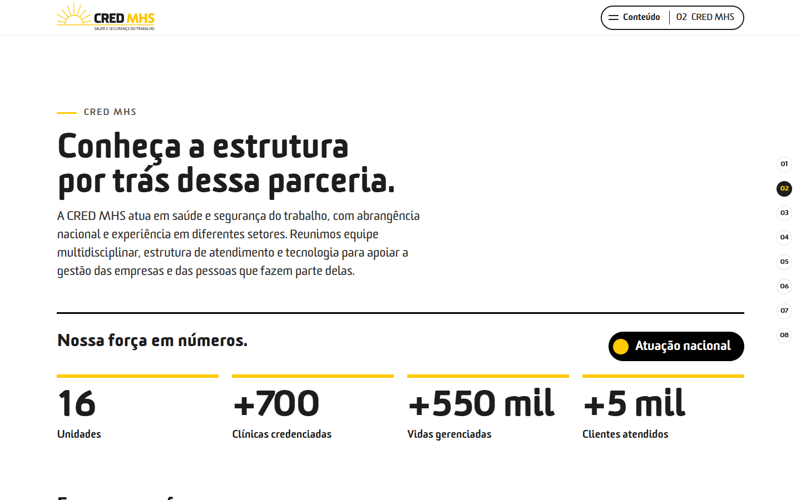

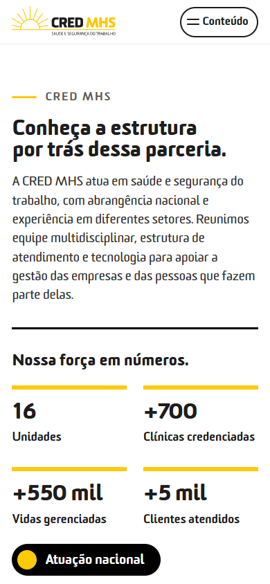

**Na tela:** “Conheça a estrutura por trás dessa parceria.”, texto institucional, **Nossa força em números** (16 unidades, +700 clínicas credenciadas, +550 mil vidas gerenciadas, +5 mil clientes atendidos, atuação nacional) e **Empresas que fazem parte da nossa trajetória** (faixa principal de logos; “Ver todas as empresas” abre o restante).

**Fala sugerida:** quem entrega, com que estrutura. Use os números como estão na tela. Não cite tempo de atuação (30, 34 ou 35 anos ainda em conflito) nem “entre as cinco maiores”.

### 03 — Relacionamento (`#relacionamento`)

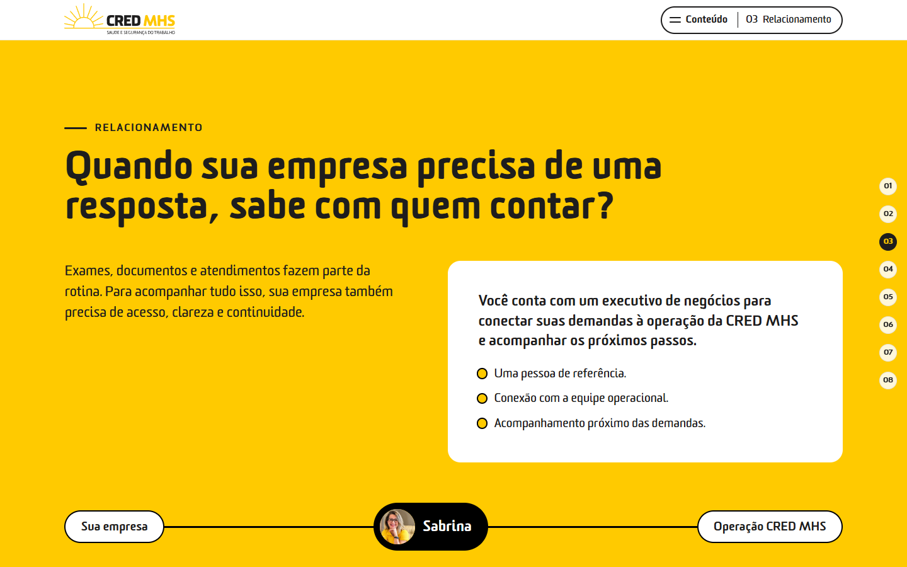

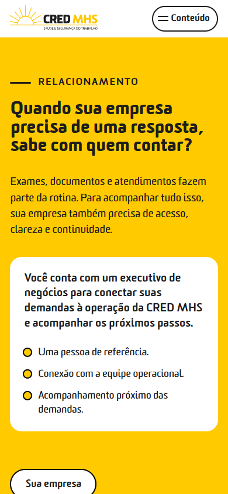

**Na tela:** “Quando sua empresa precisa de uma resposta, sabe com quem contar?” → resposta: um executivo de negócios conecta as demandas à operação. Três pontos: pessoa de referência, conexão com a equipe operacional, acompanhamento próximo. Composição Sua empresa → executivo → Operação CRED MHS.

**Fala sugerida:** a dor de quem já tem prestador: dificuldade de acesso, falta de uma pessoa de referência. Pergunte como funciona hoje. **Não prometa** reuniões periódicas, prazos, SLA, atendimento 24 h ou acompanhamento por 12 meses: nada disso foi confirmado.

### 04 — Dados (`#dados`)

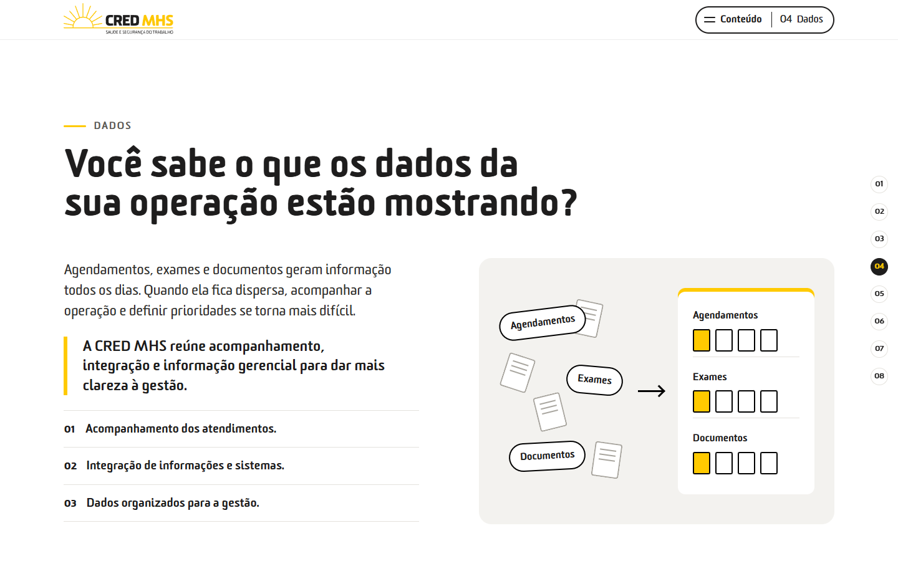

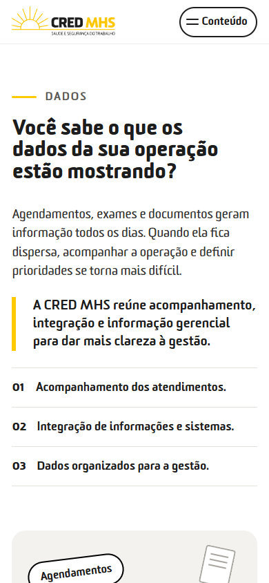

**Na tela:** “Você sabe o que os dados da sua operação estão mostrando?” → acompanhamento, integração e informação gerencial. Grafismo de informação dispersa se organizando (conceitual; não é tela de sistema).

**Fala sugerida:** informação dispersa dificulta levar a situação à diretoria. Não mostre números de desempenho nem fale em painéis com resultados que não existam.

### 05 — Gestão integrada (`#gestao-integrada`)

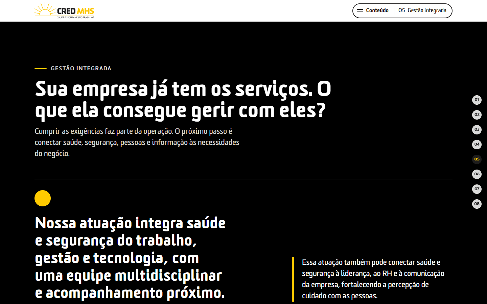

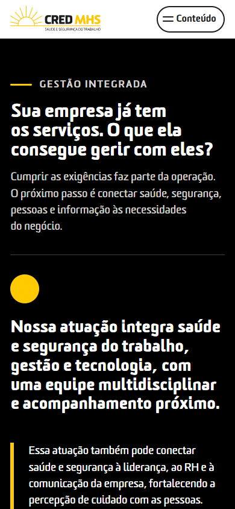

**Na tela:** “Sua empresa já tem os serviços. O que ela consegue gerir com eles?” → saúde e segurança, gestão e tecnologia integradas. Fecho: conectar saúde e segurança à liderança, ao RH e à comunicação.

**Fala sugerida:** diferenciar a CRED MHS de um catálogo de exames e documentos. O fecho prepara o eixo **Reputacional**: a percepção de cuidado com as pessoas dentro da empresa cliente. Não prometa melhoria mensurável de reputação.

### 06 — Trilha de valor (`#trilha`)

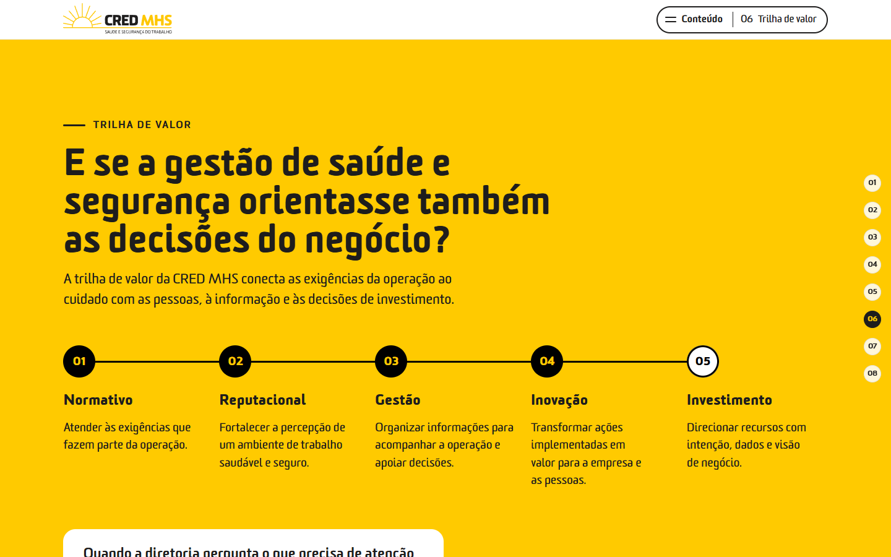

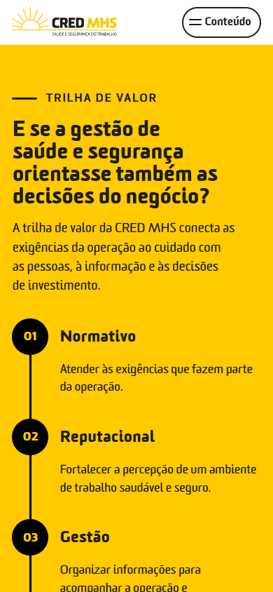

**Na tela:** “E se a gestão de saúde e segurança orientasse também as decisões do negócio?” e as cinco etapas, nesta ordem:

1. **Normativo** — atender às exigências que fazem parte da operação.
2. **Reputacional** — fortalecer a percepção de um ambiente de trabalho saudável e seguro.
3. **Gestão** — organizar informações para acompanhar a operação e apoiar decisões.
4. **Inovação** — transformar ações implementadas em valor para a empresa e as pessoas.
5. **Investimento** — direcionar recursos com intenção, dados e visão de negócio.

**Fala sugerida:** a obrigação legal é o ponto de partida; o valor cresce quando a gestão apoia decisões. A trilha **não** é avaliação do cliente, régua de maturidade, pacote nem garantia de retorno financeiro. Não fale em ROI, economia ou previsão de afastamentos.

### 07 — Soluções (`#solucoes`)

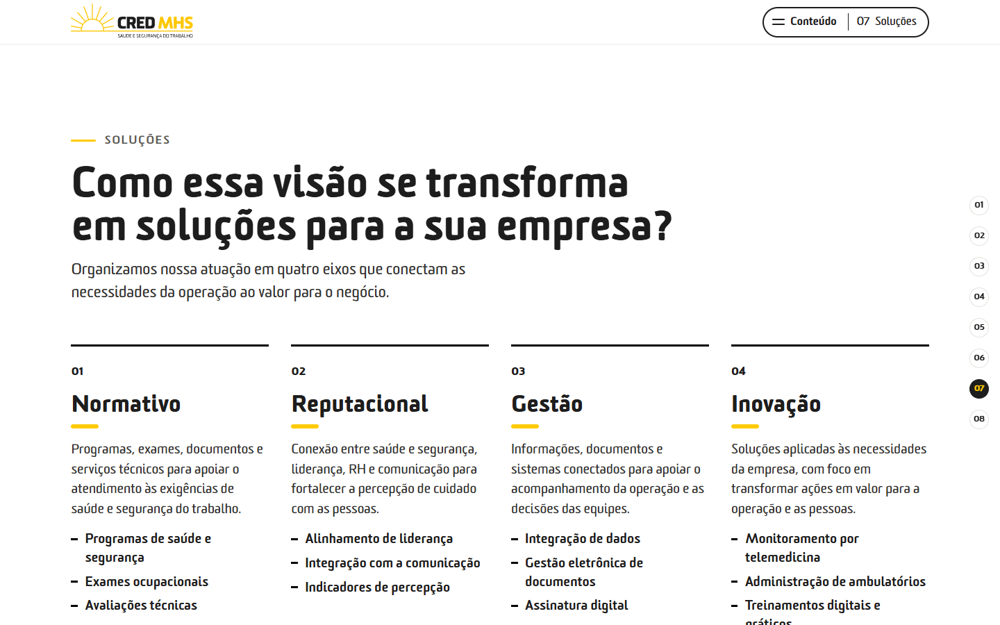

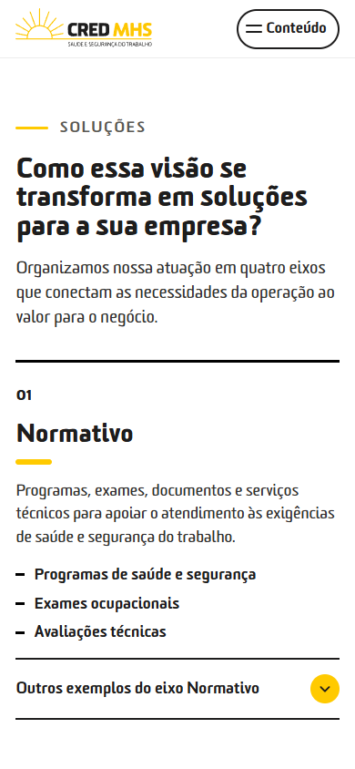

**Na tela:** “Como essa visão se transforma em soluções para a sua empresa?” e os quatro eixos, todos visíveis:

| Eixo | Exemplos na tela |
|---|---|
| Normativo | Programas de saúde e segurança · Exames ocupacionais · Avaliações técnicas |
| Reputacional | Alinhamento de liderança · Integração com a comunicação · Indicadores de percepção |
| Gestão | Integração de dados · Gestão eletrônica de documentos · Assinatura digital |
| Inovação | Monitoramento por telemedicina · Administração de ambulatórios · Treinamentos digitais e práticos |

Cada eixo pode abrir mais exemplos (opcional). Nota: “A composição das soluções considera as necessidades e o escopo de cada empresa.” Em seguida, o sub-bloco de abrangência nacional (rede própria e credenciada).

**Fala sugerida:** os eixos organizam o portfólio; não são pacotes para escolher. Investimento é etapa da trilha, não um quinto eixo. Siglas técnicas (PCMSO, PGR etc.) ficam para a conversa técnica com revisão de escopo. Não fale em inteligência artificial, BI preditivo, certificação ESG ou conformidade garantida.

### 08 — Contato (`#contato`)

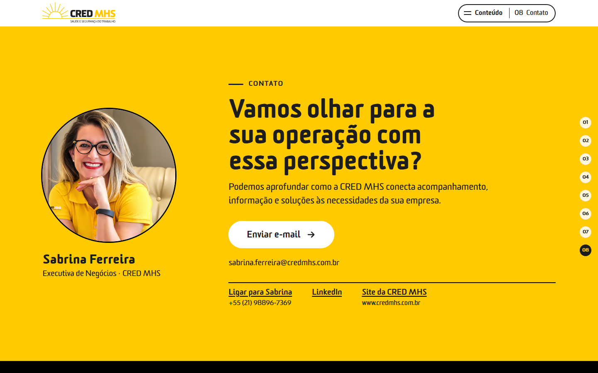


**Na tela:** “Vamos olhar para a sua operação com essa perspectiva?”, foto, nome e cargo do executivo e os botões disponíveis no perfil. Para Sabrina hoje: **Enviar e-mail**, telefone, LinkedIn e site. “Falar por WhatsApp” só aparece com número confirmado para o canal; “Agendar uma conversa” só com link real de agendamento (nenhum dos dois existe hoje).

**Fala sugerida:** combinar o próximo passo. Os botões só abrem o aplicativo de e-mail, o telefone ou o navegador do visitante; nada é enviado sozinho.

---

## 4. Roteiros de uso

### Antes da reunião

- Abra o link com o seu identificador e confira foto, nome, cargo e contatos.
- Confirme que o e-mail e o telefone do perfil estão corretos (painel, item 5).
- Tenha à mão as respostas para as pendências do item 7, caso o cliente pergunte.

### (a) Reunião ao vivo (presencial ou tela compartilhada) — 10 a 15 minutos

1. **Abertura (1 min):** retome o contato e apresente-se.
2. **CRED MHS (2 min):** números e empresas. Deixe o cliente ver os logos.
3. **Relacionamento e Dados (3 min):** faça as duas perguntas e ouça. Use a resposta da tela como síntese.
4. **Gestão integrada (1 min):** do serviço à gestão; introduza liderança, RH e comunicação.
5. **Trilha (2 min):** percorra as cinco etapas em ordem, sem classificar o cliente.
6. **Soluções (3 min):** comente os eixos ligados ao que o cliente contou; abra exemplos só se ajudar.
7. **Contato (1 min):** combine o próximo passo.

Para pular para uma dobra, use o menu **Conteúdo** (topo) ou o índice lateral em telas largas.

### (b) Link encaminhado a um decisor que não participou da conversa

A página foi escrita para funcionar sem explicação. Envie o link com uma frase curta de contexto. O decisor lê de cima a baixo em poucos minutos e termina com os botões de contato do executivo certo.

### (c) Versão rápida (5 minutos)

Abertura → CRED MHS → Trilha → Soluções → Contato.

---

## 5. Perfis e painel

- **Painel:** `/painel/` (ex.: `http://localhost:5173/painel/`). Login com e-mail e senha, sem cadastro público; acesso por convite.
- Cada executivo edita **somente o próprio perfil**: nome, nome de apresentação, cargo, e-mail de contato, telefone e foto. O painel tem “Copiar meu link de apresentação” e “Abrir minha apresentação”.
- LinkedIn, site e WhatsApp são administrados no banco, fora do painel. WhatsApp continua desligado até confirmação do número.
- **Situação atual:** o painel e o Supabase foram testados só com serviço **simulado**. Sem as credenciais do projeto real, o painel mostra “Painel ainda não configurado” e a apresentação usa o perfil local de Sabrina. Passo a passo: `docs/CONFIGURACAO-SUPABASE.md`.
- A V2 não alterou o painel, o login nem as permissões.

---

## 6. Boas práticas

- Fale “CRED MHS”, não só “CRED”. Assinatura: “Saúde e Segurança do Trabalho”.
- Perguntas da página são retóricas: não peça ao cliente que responda na tela.
- Não amplie promessas da tela: sem prazos, SLA, reuniões periódicas, ROI, economia, IA ou certificações não confirmadas.
- Reputacional é sobre a empresa do cliente (liderança, RH, comunicação, percepção de cuidado), não sobre a fama da CRED MHS.
- Não use “Você levou laudo ou estratégia?” nem frases da concorrente.

---

## 7. Pendências que a Sabrina/CRED precisa confirmar

Detalhes em `docs/07-fontes-e-pendencias.md`.

| ID | O que confirmar |
|---|---|
| P01 | Tempo de atuação único (30, 34 ou 35 anos) |
| P02 | Fonte e critério de “entre as cinco maiores” |
| P03 | Data-base e denominação dos números (unidades, clínicas, vidas, clientes atendidos) |
| P04 | “27 estados” ou “27 unidades federativas” |
| P05 / P06 | Certificações ISO (titular, escopo, vigência) e como falar de LGPD |
| P07 | Empresas em destaque e autorização de citação |
| P09 / P10 / P37 | Catálogo de cursos e siglas técnicas (PCMAT, PPRA etc.) atualizados |
| P13 / P14 | Número de WhatsApp e link de agendamento |
| P33 | Enviar os dois JPEGs dos frameworks para o projeto |
| P36 | Significado de “OK’s e KPI’s” no eixo Reputacional |
| P38 | Onde ficam Riscos Psicossociais e Gestão de Absenteísmo nos quatro eixos |
| P39 | Frequência de reuniões, duração de acompanhamento e SLA |
| P40 | Logo oficial com a assinatura atual |
| P41 | Validação da copy V2 pela Sabrina |

---

## 8. Parte técnica (resumo)

> **Não está publicado.** Sem deploy, envio de e-mail, CRM ou analytics.

**Base:** Vite + React + TypeScript; Supabase opcional (perfis e painel).

```bash
npm install          # só na primeira vez
npm run dev          # http://localhost:5173/?executivo=sabrina-ferreira
npm run build        # verifica os tipos e gera dist/
npm run preview      # http://localhost:4173/?executivo=sabrina-ferreira
```

| Arquivo | Conteúdo |
|---|---|
| `src/content/chapters.ts` | Textos das oito dobras e ordem do índice |
| `src/content/solutions.ts` | Quatro eixos: resumo, exemplos, aprofundamento e inventário interno |
| `src/content/valueTrail.ts` | Cinco etapas da trilha |
| `src/content/facts.ts` | Números e dados retidos por pendência |
| `src/content/clients.ts` | Empresas da trajetória |
| `src/content/executives.ts` | Perfil local de Sabrina |
| `src/content/coverage.ts` | Rastreabilidade fonte → dobra (interno) |
| `docs/REVISAO-CRED-MHS-V2.md` | Direção da V2 |
| `docs/V2-MAPEAMENTO-FRAMEWORKS.md` | Frameworks, matriz V1 → V2 e itens não exibidos |
| `qa/RELATORIO.md` | O que foi testado e o que ficou pendente |

**Para trocar um texto:** edite `src/content/` e rode `npm run build`. Registre dados confirmados pela CRED em `docs/07-fontes-e-pendencias.md`.
