# Guia da apresentação comercial CRED MHS

> **Superado em 14/10/2026 pela V2.** Guia ativo: `docs/guia/GUIA-DA-APRESENTACAO.md`. Este arquivo descreve a V1 (prioridades, pauta e mensagem), que foi retirada; as imagens citadas ficam em `docs/guia/img/` como histórico.

Material de estudo para Nil e Sabrina Ferreira. Explica o que a apresentação é, como abrir, o que cada parte mostra, o que dá para fazer com ela e como usá-la bem com clientes e prospects.

> **Situação em 08/10/2026:** a apresentação existe só como **versão local**, no computador onde o projeto roda. Ela **ainda não foi publicada** na internet. Enquanto não houver publicação, o link funciona apenas nessa máquina e não pode ser enviado a um cliente.

As imagens deste guia ficam em `docs/guia/img/` e foram capturadas na versão local em 08/10/2026, no computador (1440 px de largura) e no celular (390 px). O nome "Indústria Exemplo" aparece nelas só como exemplo de preenchimento.

---

## 1. O que é a apresentação

É uma página web única, organizada em **10 momentos** (M01 a M10). Ela conta quem é Sabrina, o que a CRED MHS faz e termina com uma **pauta de conversa** montada pelo próprio visitante.

**Para quem:** decisores e interlocutores de empresas, inclusive grandes empresas e multinacionais. A leitura principal é comercial e direta. Siglas, normas e listas técnicas ficam guardadas em áreas que só abrem quando a pessoa pede ("Ver serviços", "Conhecer a solução" etc.).

**Dois jeitos de usar:**
- Sabrina conduz a apresentação numa reunião, presencial ou com tela compartilhada.
- O cliente abre o link e lê sozinho.

**Como a página se adapta:** ela muda conforme as escolhas que o visitante faz de propósito: até duas prioridades, o nome da empresa (opcional) e os assuntos que ele adiciona à conversa. A página **não analisa** a empresa, **não dá nota**, não faz diagnóstico nem recomenda serviço.

**O que a apresentação NÃO é:**
- **Não é contrato nem proposta.** Não tem preço, pacote nem botão de contratar. A própria página avisa: *"A seleção organiza nossa conversa. O escopo da atuação será discutido com a sua empresa."*
- **Não é diagnóstico.** Escolher "Segurança do Trabalho" não significa que a empresa tem um problema nessa área.
- **Não é formulário.** Nada do que o visitante digita ou escolhe vai para a CRED, para Sabrina ou para outro lugar.
- **Nada é enviado sozinho.** Os botões de contato só abrem o aplicativo de e-mail, o telefone ou o navegador do visitante. Quem decide enviar é ele. A página diz isso: *"Os botões abrem o seu aplicativo de e-mail, telefone ou navegador. Nada é enviado automaticamente."*
- **Sem CRM, sem analytics, sem rastreamento.** A página não registra quem abriu nem o que foi escolhido. Os testes de QA confirmaram zero requisições a serviços de terceiros.

---

## 2. Como abrir

### O link

Enquanto for versão local, o endereço é:

```
http://localhost:4173/?executivo=sabrina-ferreira
```

(Ou `http://localhost:5173/?executivo=sabrina-ferreira` quando o projeto está em modo de desenvolvimento. Veja a parte técnica, no item 10.)

- O trecho `?executivo=sabrina-ferreira` define **quem é o executivo** da apresentação: foto, nome, cargo e contatos.
- **Sem esse trecho**, a página abre com Sabrina mesmo assim.
- **Com um nome errado** (ex.: `?executivo=fulano`), a página também abre com Sabrina. Ela é o único perfil cadastrado, e não existe perfil genérico com contatos inventados.
- O link **nunca** carrega o nome da empresa nem a pauta. Por isso dá para reutilizar o mesmo link com qualquer cliente.

### Ir direto para um momento

Acrescente `#` e o código ou o nome do momento no fim do link:

| Momento | Código | Nome no link |
|---|---|---|
| M01 Apresentação | `#m01` | `#apresentacao` |
| M02 Suas prioridades | `#m02` | `#prioridades` |
| M03 Estrutura | `#m03` | `#estrutura` |
| M04 Empresas | `#m04` | `#empresas` |
| M05 Ecossistema | `#m05` | `#ecossistema` |
| M06 Gestão e tecnologia | `#m06` | `#gestao-e-tecnologia` |
| M07 Aplicações | `#m07` | `#aplicacoes` |
| M08 Confiança | `#m08` | `#confianca` |
| M09 Sua pauta | `#m09` | `#sua-pauta` |
| M10 Contato | `#m10` | `#contato` |

Exemplo: `http://localhost:4173/?executivo=sabrina-ferreira#ecossistema` abre direto no ecossistema. Se o nome depois do `#` não existir, a página abre normalmente no início.

---

## 3. Mapa dos 10 momentos

Ordem e ritmo pensados no projeto: **entrada humana → participação → evidência de escala → prova social → exploração → explicação em movimento → aplicações → confiança → síntese → contato.**

### M01 — Apresentação ("Olá, eu sou Sabrina.")

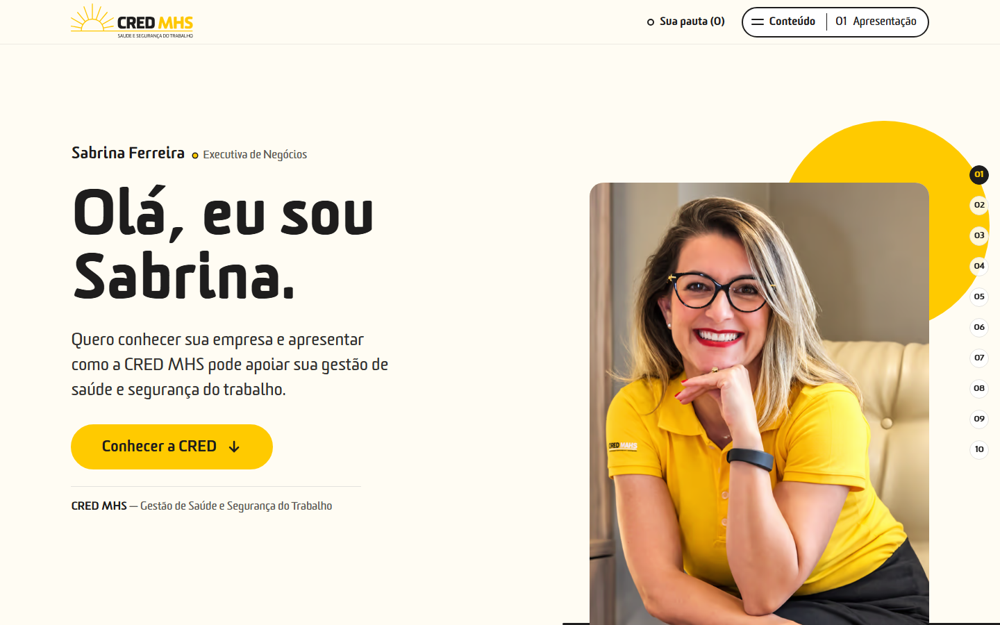

- **Objetivo:** responder "quem vai conversar comigo?".
- **O que aparece:** foto de Sabrina, "Sabrina Ferreira · Executiva de Negócios", o título *"Olá, eu sou Sabrina."* e o texto *"Quero conhecer sua empresa e apresentar como a CRED MHS pode apoiar sua gestão de saúde e segurança do trabalho."* Embaixo, a assinatura "CRED MHS — Gestão de Saúde e Segurança do Trabalho".
- **O que dá para fazer:** o botão **"Conhecer a CRED"** leva ao M02. Não há cadastro, login nem pedido de e-mail.
- **Personalização:** nome, cargo e foto vêm do link (`?executivo=`).
- **Como conduzir:** é o momento de se apresentar com as próprias palavras. A tela reforça o que Sabrina diz e não precisa ser lida em voz alta.

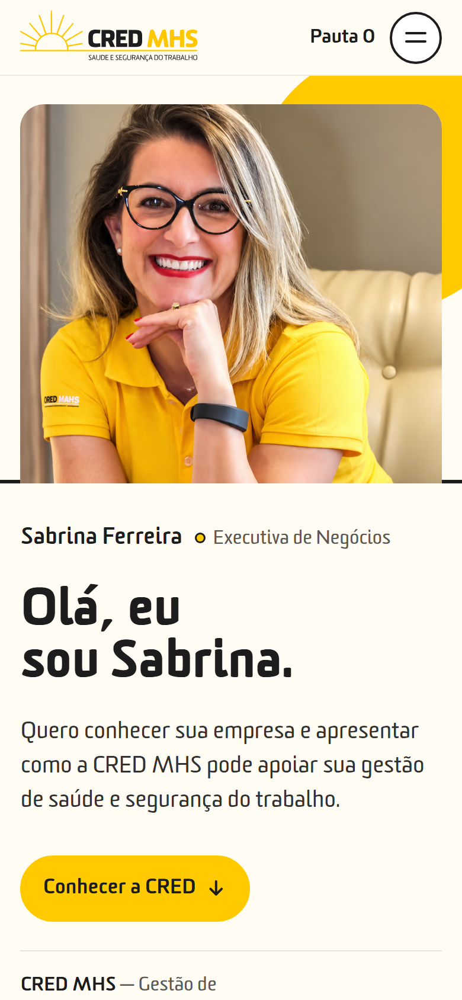

### M02 — Suas prioridades ("A gestão de saúde e segurança começa pelo seu negócio")

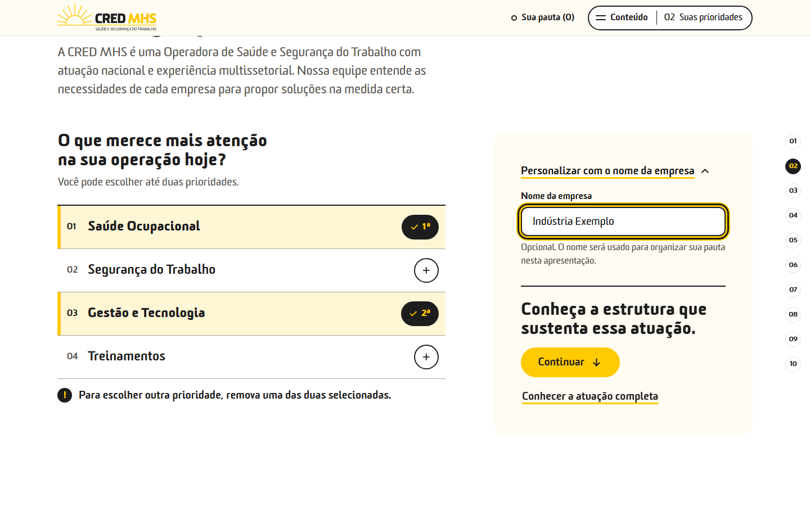

- **Objetivo:** envolver o visitante e responder "o que é relevante para minha empresa?".
- **O que aparece:** apoio institucional (*"A CRED MHS é uma Operadora de Saúde e Segurança do Trabalho com atuação nacional e experiência multissetorial…"*) e a pergunta *"O que merece mais atenção na sua operação hoje?"*, com quatro opções: **Saúde Ocupacional**, **Segurança do Trabalho**, **Gestão e Tecnologia** e **Treinamentos**. Logo abaixo da pergunta: *"Escolha até duas prioridades."* e *"Ao explorar as soluções, você pode reunir assuntos para conversar com Sabrina."*, que antecipa a pauta do final.
- **O que dá para fazer:**
  - Escolher **até duas** prioridades. A escolhida fica marcada com ✓ e com a ordem (1ª, 2ª).
  - Abrir **"Personalizar com o nome da empresa"** e digitar o nome (opcional).
  - **"Continuar"** segue para M03, com ou sem escolhas.
  - **"Conhecer a atuação completa"** apaga as prioridades e segue para M03. Os assuntos já adicionados à pauta continuam lá.
- **Resposta da página:** com uma escolha feita, aparece *"Vamos destacar essas frentes ao longo da apresentação."* Nada avança sozinho: a página só se move quando alguém clica em "Continuar".
- **Como conduzir:** faça a pergunta ao cliente em voz alta e deixe que ele escolha, ou clique pelo que ele disser. É a pergunta que abre a conversa. Use o nome da empresa só se o cliente concordar: ele aparece no título da pauta (M09) e na mensagem final (M10).

### M03 — Estrutura ("Estrutura nacional para apoiar sua operação")

- **Objetivo:** mostrar capacidade e responder "a CRED tem estrutura para nos acompanhar?".
- **O que aparece:** *"Atuação nacional"* e quatro números, com estes rótulos exatos: **16 Unidades**, **+700 Clínicas credenciadas**, **+550 mil Vidas gerenciadas** e **+5 mil Clientes atendidos**.
- **O que dá para fazer:** **"Conhecer a estrutura"** abre três detalhes: *Equipe multidisciplinar*, *Recursos próprios* e *Atendimento na empresa* (exames ocupacionais in company).
- **Personalização:** o detalhe ligado a uma prioridade escolhida recebe o selo **"Sua prioridade"**. Saúde Ocupacional marca "Atendimento na empresa". Segurança do Trabalho marca "Equipe multidisciplinar" e "Recursos próprios".
- **Como conduzir:** leia os números **com os rótulos exatos**. "Clientes atendidos" não é o mesmo que "clientes ativos", e "clínicas credenciadas" não são unidades próprias. Não some os números.

### M04 — Empresas ("Empresas no percurso da CRED")

- **Objetivo:** prova social.
- **O que aparece:** *"Conheça algumas das empresas que fazem parte do percurso da CRED MHS."* e 8 logotipos em destaque.
- **O que dá para fazer:** **"Ver outras empresas"** mostra a relação completa na própria página (37 nomes do material original). "Mostrar menos empresas" recolhe a lista.
- **Como conduzir:** fale em "empresas no percurso da CRED". Não diga que todas são clientes atuais e não atribua resultados ou cases a um logotipo. Isso não está documentado (pendência P07).

### M05 — Ecossistema ("Soluções conectadas à realidade da sua empresa")

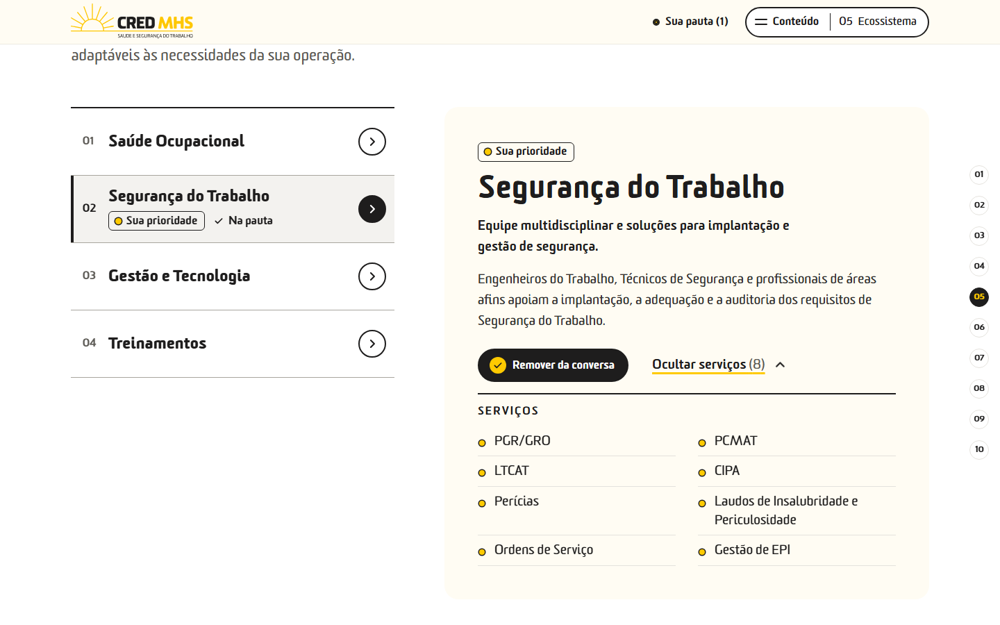

- **Objetivo:** mostrar a oferta e responder "o que a CRED pode oferecer?".
- **O que aparece:** uma instrução única, antes das frentes: *"Use “Adicionar à conversa” nos assuntos que quiser retomar com Sabrina. Eles aparecem na sua pauta, no final."* Os itens repetem só o rótulo do botão. Depois, as quatro frentes, cada uma com resumo, texto de detalhe e catálogo:
  - **Saúde Ocupacional:** PCMSO, ASO, Relatório Anual, PPP, gestão de exames, convocação de periódicos, exames in company, mais um "Aprofundamento técnico" (*"Além dos documentos obrigatórios, a CRED oferece ferramentas auxiliares para organizar e acompanhar a gestão de saúde do trabalho."*).
  - **Segurança do Trabalho:** PGR/GRO, PCMAT, LTCAT, CIPA, Perícias, Laudos de Insalubridade e Periculosidade, Ordens de Serviço, Gestão de EPI.
  - **Gestão e Tecnologia:** 9 recursos (integração com ERP, importação e exportação de dados, GED, assinatura digital, aplicativo, acervo fotográfico, saúde remota, biometria, nuvem).
  - **Treinamentos:** central EAD com *"mais de 77 cursos"* e 12 temas de NR em "Ver temas de treinamento".
  - Em seguida, **"Outras necessidades da operação"**: 10 serviços adicionais (Gestão de Absenteísmo, Monitoramento por Telemedicina, Administração de Ambulatórios, Plano de Continuidade de Negócios, Locação de Mão de Obra, Locação de Veículo de Urgência e Emergência, Análise Ergonômica, Campanhas Vacinais, Ginástica Laboral e afins, SIPAT Digital).
- **O que dá para fazer:**
  - Clicar numa frente para ler. **Ler não adiciona nada à pauta.**
  - **"Ver serviços"** abre o catálogo da frente, e "Ocultar serviços" fecha.
  - **"Adicionar à conversa"** coloca a frente ou o serviço na pauta. O botão passa a **"Remover da conversa"** (preenchido, com ✓) e a frente ganha o selo **"Na pauta"**.
- **Personalização:** a frente que abre primeiro é a **1ª prioridade** escolhida. Sem prioridade, abre Saúde Ocupacional. As frentes escolhidas têm o selo **"Sua prioridade"**, mas todas continuam visíveis: nada fica escondido. Se alguém trocar de frente manualmente, essa escolha vale até as prioridades mudarem.
- **Como conduzir:** é o momento de explorar com o cliente. Quando ele comentar algo ("isso aqui a gente precisa"), clique em **"Adicionar à conversa"** na hora. O contador **"Sua pauta (n)"** no topo sobe, e o cliente vê a pauta crescer.

### M06 — Gestão e tecnologia ("Informações para acompanhar a gestão")

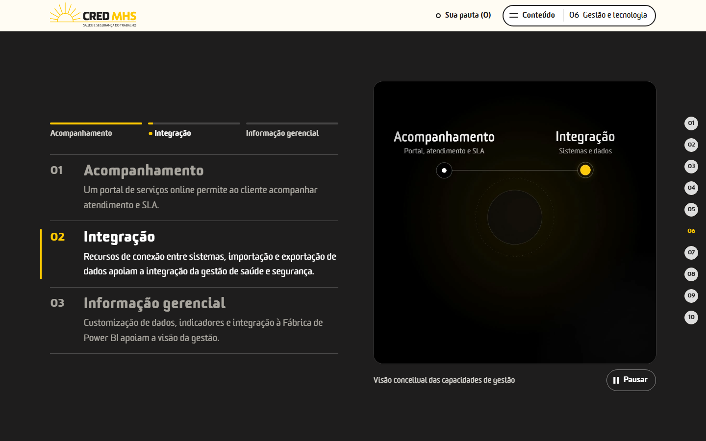

- **Objetivo:** mostrar como a tecnologia apoia a gestão.
- **O que aparece:** três aspectos. **Acompanhamento** (*"Um portal de serviços online permite ao cliente acompanhar atendimento e SLA."*), **Integração** e **Informação gerencial** (*"Customização de dados, indicadores e integração à Fábrica de Power BI…"*). Ao lado, uma animação curta com a legenda *"Visão conceitual das capacidades de gestão"*.
- **O que dá para fazer:**
  - No computador, ao rolar a página, o bloco fica parado e os três aspectos se revezam. Os marcadores no topo (Acompanhamento / Integração / Informação gerencial) levam direto a cada um.
  - A animação fica em repetição contínua, lenta e sutil: se forma, respira e se dissolve. Toca sozinha quando aparece na tela e tem botão **Pausar / Reproduzir**.
  - A animação mostra os três aspectos **juntos, sem destacar nenhum**. Quem indica o aspecto em leitura é só a rolagem (marcador no topo e texto ativo). Assim o vídeo não sugere uma etapa diferente da que está sendo explicada.
  - **"Explorar recursos de tecnologia"** abre a lista de 9 recursos complementares.
  - **"Adicionar à conversa"** coloca "Gestão e Tecnologia" na pauta.
  - **"Ir para aplicações"** pula para M07.
- **Atenção:** a animação é um **esquema conceitual**. **Não é uma tela do sistema** e não deve ser apresentada como demonstração de software.
- **No celular** (e com "reduzir movimento" ativado no aparelho), os três aspectos aparecem um embaixo do outro, com imagem fixa. O conteúdo é o mesmo.

### M07 — Aplicações ("Qual necessidade vamos aprofundar?")

- **Objetivo:** aprofundar necessidades específicas.
- **O que aparece:** três aplicações. **eSocial**, **Gestão de FAP/NTEP** e **Riscos Psicossociais** (*"Programa de Vigilância Epidemiológica estruturado sob medida."*).
- **O que dá para fazer:** **"Conhecer a solução"** abre o texto completo (e "Fechar" recolhe). **"Adicionar à conversa"** coloca o tema na pauta. **"Ver outras soluções"** volta ao catálogo adicional do M05.
- **Personalização:** quem escolheu **Gestão e Tecnologia** vê o selo "Sua prioridade" em eSocial e em FAP/NTEP. Riscos Psicossociais fica disponível para todos e nunca é destacado automaticamente.
- **Como conduzir:** não chame Riscos Psicossociais de "VIVA" (pendência P16). Não fale em "4 soluções para o eSocial": as modalidades não estão descritas (P08). Também não prometa redução de alíquota ou economia com FAP/NTEP.

### M08 — Confiança ("Pessoas e estrutura para apoiar a gestão")

- **Objetivo:** apresentar referências que sustentam a apresentação.
- **O que aparece hoje:** três pontos, *Equipe multidisciplinar*, *Equipamentos próprios* e *Recursos de acompanhamento*.
- **Por que não há certificações ISO nem LGPD:** o material original cita ISO 9001, 45001 e 27001, mas sem dizer quem é o titular, qual o escopo e qual a validade, e os slides divergem entre si. Enquanto isso não for confirmado, esta seção mostra **pessoas e estrutura** (pendências P05 e P06). Quando a CRED confirmar os dados, a seção pode passar a mostrar as credenciais.
- **Como conduzir:** se o cliente perguntar sobre certificações, responda com a informação oficial que você tiver em mãos. Não use a apresentação como prova.

### M09 — Sua pauta ("Uma conversa sobre a sua operação" / "Uma conversa sobre {empresa}")

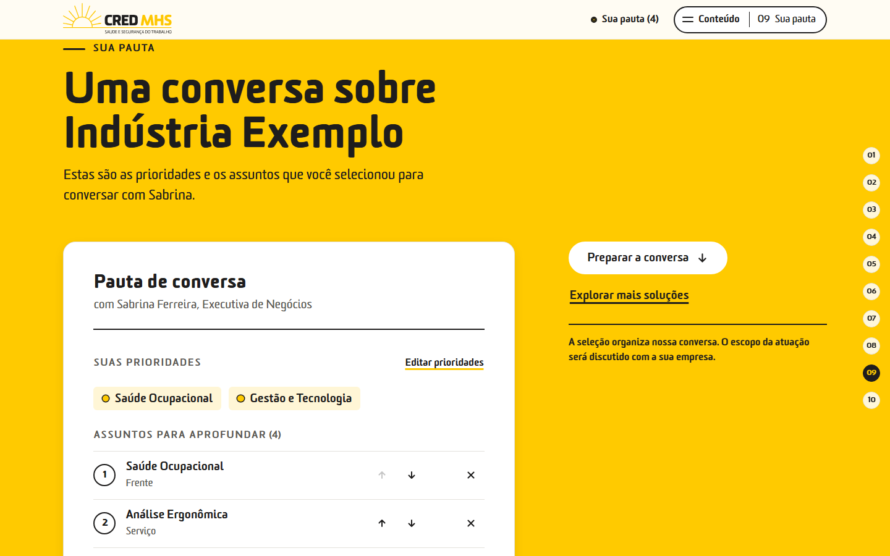

- **Objetivo:** reunir o que o visitante escolheu ("sobre o que vale conversar agora?").
- **O que aparece:** com nome da empresa, o título vira *"Uma conversa sobre Indústria Exemplo"*. Abaixo, a folha **"Pauta de conversa — com Sabrina Ferreira, Executiva de Negócios"**, dividida em dois grupos: **Suas prioridades** e **Assuntos para aprofundar (n)**. Cada assunto mostra o tipo: Frente, Aplicação, Serviço ou **Seu assunto** (escrito à mão).
- **O que dá para fazer:** veja o item 4.
- **Pauta vazia:** aparece *"Podemos começar entendendo sua operação. Se preferir, explore as soluções e selecione os assuntos que deseja conversar."* O contato continua liberado mesmo assim.
- **Como conduzir:** leia a pauta com o cliente e pergunte "é isso mesmo? falta algo?". Ajuste ali, junto com ele. Essa pauta vira o roteiro da próxima conversa. Para guardá-la, use **"Copiar pauta"** aqui mesmo, no M09.

### M10 — Contato ("Vamos conversar sobre a sua empresa?")

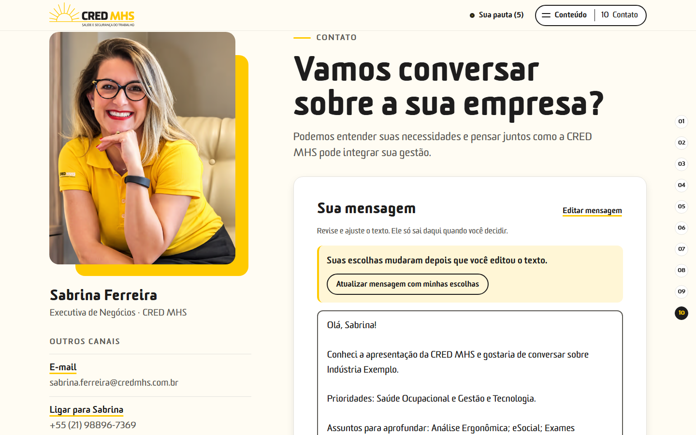

- **Objetivo:** dar o próximo passo com a mesma executiva da abertura.
- **O que aparece:** foto e nome de Sabrina, o bloco **"Sua mensagem"** com um texto pronto, os botões de ação e "Outros canais".
- **O que dá para fazer:** veja o item 4 (mensagem e canais).
- **Como conduzir:** numa reunião, Sabrina pode mostrar que o cliente leva a pauta com ele ("Copiar pauta") ou deixar a mensagem preparada para ele mesmo enviar. Nada sai da página sem a ação do cliente.

---

## 4. Personalização em detalhe

### Prioridades (M02)

- No máximo **duas**, guardadas na ordem em que foram escolhidas (1ª e 2ª).
- Na tentativa de uma terceira, as duas escolhas ficam como estão e aparece: *"Para escolher outra prioridade, remova uma das duas selecionadas."* Para trocar, desmarque uma e marque outra.
- "Continuar" funciona com zero, uma ou duas escolhas.
- Para mudar depois, use **"Editar prioridades"** no M09, que leva de volta ao M02.

### Nome da empresa (M02)

- Fica em **"Personalizar com o nome da empresa"**. É opcional, com até 80 caracteres. Texto de apoio: *"Opcional. O nome será usado para organizar sua pauta nesta apresentação."*
- Aparece só no título do M09, na mensagem do M10 e no texto copiado da pauta. Não vai para o título da aba, para o link nem para lugar nenhum fora da página.

### O que muda com as prioridades (destaques)

| Prioridade | O que fica destacado |
|---|---|
| Saúde Ocupacional | Frente Saúde Ocupacional no M05; "Atendimento na empresa" no M03 |
| Segurança do Trabalho | Frente Segurança do Trabalho no M05; "Equipe multidisciplinar" e "Recursos próprios" no M03 |
| Gestão e Tecnologia | Frente Gestão e Tecnologia no M05; M06; eSocial e FAP/NTEP no M07 |
| Treinamentos | Frente Treinamentos no M05 (EAD e temas) |

"Destaque" é só o selo **"Sua prioridade"** e a frente que abre primeiro no M05. **Nada some, a ordem dos capítulos não muda e não há avaliação.**

### "Adicionar à conversa"

- Existe nas frentes (M05), nos 10 serviços adicionais (M05), em Gestão e Tecnologia (M06) e nas três aplicações (M07).
- Clicar de novo ("Remover da conversa") tira o item da pauta. Não há duplicação: o mesmo assunto entra uma vez só.
- Abrir, ler ou visitar um tema **não** o adiciona. Para entrar na pauta, alguém precisa clicar no botão.

### Contador "Sua pauta (n)"

- Fica no topo da página, em todos os momentos. No celular, aparece como **"Pauta n"**.
- Conta **os assuntos** da pauta (do catálogo e escritos à mão). **Prioridades não entram na conta.**
- Clicar nele leva direto ao M09.

### Pauta editável (M09)

- **Remover:** botão × ao lado de cada assunto.
- **Reordenar:** setas ↑ e ↓ ("Mover para cima" / "Mover para baixo").
- **Incluir um assunto livre:** campo **"Incluir outro assunto"** + botão **"Incluir"**. São até 120 caracteres por item e até 20 itens livres. Texto vazio ou repetido não entra (*"Esse assunto já está na pauta."*).
- **Editar:** só os itens escritos à mão ("Seu assunto") têm o botão **"Editar"**. Os nomes do catálogo não podem ser alterados.
- **"Limpar escolhas":** pede confirmação (*"Limpar escolhas?"*) e apaga prioridades e assuntos. **O nome da empresa é mantido.** "Manter pauta" cancela.
- **"Preparar a conversa"** leva ao M10. **"Explorar mais soluções"** volta ao M05.
- **"Copiar pauta"** (ao lado de "Explorar mais soluções"): copia a pauta organizada sem precisar rolar até a mensagem. É o mesmo texto do "Copiar pauta" do M10, e a página confirma *"Pauta copiada."*. Com a pauta vazia, o botão fica desabilitado e aparece *"Escolha uma prioridade ou adicione um assunto para copiar a pauta."*. Útil quando Sabrina conduz a reunião no próprio computador e quer guardar a seleção sem abrir um e-mail.

### Mensagem (M10)

- O texto é montado com as escolhas. Exemplo real gerado no teste:

  > Olá, Sabrina!
  >
  > Conheci a apresentação da CRED MHS e gostaria de conversar sobre Indústria Exemplo.
  >
  > Prioridades: Saúde Ocupacional e Gestão e Tecnologia.
  >
  > Assuntos para aprofundar: Análise Ergonômica; eSocial; Exames periódicos da filial de Campinas.
  >
  > Podemos conversar sobre como a CRED pode apoiar nossa gestão?

  Se uma frente já aparece como prioridade, ela não se repete em "Assuntos para aprofundar". Sem nenhuma escolha, a mensagem é curta e genérica.
- **"Editar mensagem":** permite reescrever o texto livremente.
- **Mensagem desatualizada:** se as escolhas mudarem **depois** de o texto ser editado, a página não apaga o que foi escrito. Aparece *"Suas escolhas mudaram depois que você editou o texto."* e o botão **"Atualizar mensagem com minhas escolhas"**, que troca o texto editado pela versão nova. Até alguém clicar nele, o e-mail usa o texto editado.
- **"Preparar e-mail para Sabrina":** abre o aplicativo de e-mail do visitante com destinatário (sabrina.ferreira@credmhs.com.br), assunto ("Conversa sobre a CRED MHS") e o texto. A página confirma: *"Mensagem preparada. Revise e envie pelo seu aplicativo de e-mail."* **Não diz "enviado" porque nada foi enviado.**
- **"Copiar mensagem"** e **"Copiar pauta":** copiam o texto para colar onde quiser, como WhatsApp, Teams ou e-mail do navegador. Se o navegador bloquear a cópia, a página mostra o texto selecionado para copiar à mão.
- **Mensagem longa:** se o texto ficar grande demais para caber no link de e-mail, aparece *"A mensagem ficou longa para abrir completa no e-mail. Copie o texto e cole na mensagem que será aberta."* "Copiar mensagem" vira o botão principal, e o e-mail abre só com destinatário e assunto. A página nunca corta a pauta sem avisar.
- **"Voltar"** retorna ao M09.
- O texto editado **não fica salvo**: ao recarregar a página, ele volta à versão gerada pelas escolhas.

### Canais de contato

| Canal | Como aparece | Situação |
|---|---|---|
| E-mail | "Preparar e-mail para Sabrina" + "E-mail sabrina.ferreira@credmhs.com.br" em "Outros canais" | Ativo (confirmar se o endereço pode ficar visível na versão publicada: P23) |
| Telefone | "Ligar para Sabrina — +55 (21) 98896-7369" | Ativo |
| LinkedIn | "Ver LinkedIn — linkedin.com/in/sabrinaferreira" (abre em nova aba) | Ativo |
| Site | "Site da CRED MHS — www.credmhs.com.br" (abre em nova aba) | Ativo |
| WhatsApp | **Não aparece** | **Oculto de propósito** |
| Agendamento | **Não aparece** | Não existe link de agenda (P14) |

**Por que o WhatsApp está oculto:** existe um número de telefone, mas ninguém confirmou que ele atende pelo WhatsApp (pendência P13). A apresentação já está preparada para o botão *"Conversar com Sabrina pelo WhatsApp"*. Ele aparece quando a CRED/Sabrina confirmar o número do canal. Ninguém testou o canal mandando mensagem.

---

## 5. Navegação

- **Rolagem normal:** a página é uma só, e basta rolar. Cada momento termina com um botão ou frase que leva ao próximo.
- **Menu "Conteúdo"** (canto superior direito): abre a lista dos 10 momentos, com *"você está aqui"* no atual. No final do menu fica **"Nova apresentação"**. Ao lado do botão aparece o momento atual (ex.: "05 Ecossistema").

  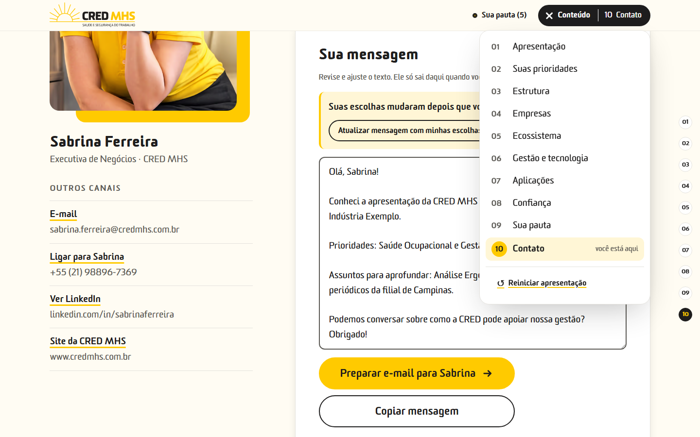

- **Índice lateral (01 a 10):** em telas largas (a partir de 1280 px), uma coluna de números à direita leva direto a cada momento. O atual fica preto. Em telas menores, use o menu "Conteúdo".
- **Logo CRED MHS** no topo: volta ao M01.
- **Teclado:** Tab percorre todos os botões, com contorno visível. No menu "Conteúdo", as setas ↑/↓ e Home/End navegam, e **Esc** fecha. Esc também fecha as janelas de confirmação.
- **Celular:** o topo mostra "Pauta n" e um botão de menu (☰), que é o "Conteúdo". As opções são grandes para o toque, e o M05 vira uma lista que abre e fecha.

  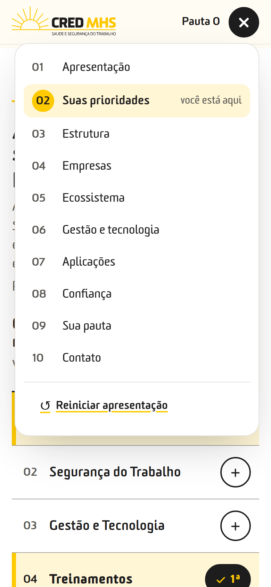 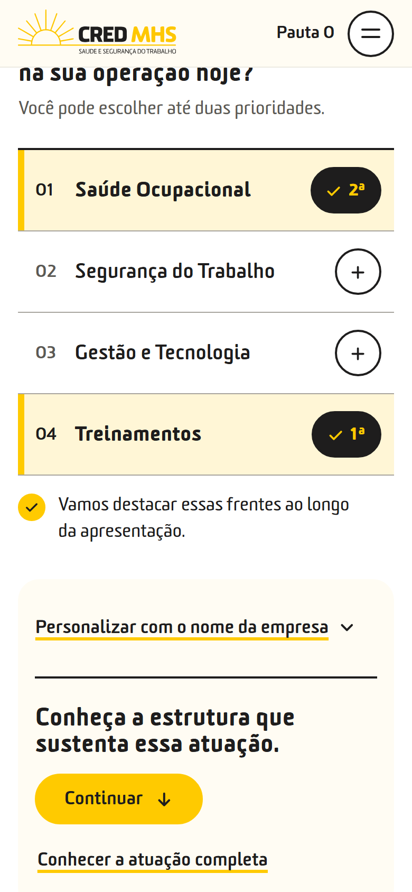

### Nova apresentação

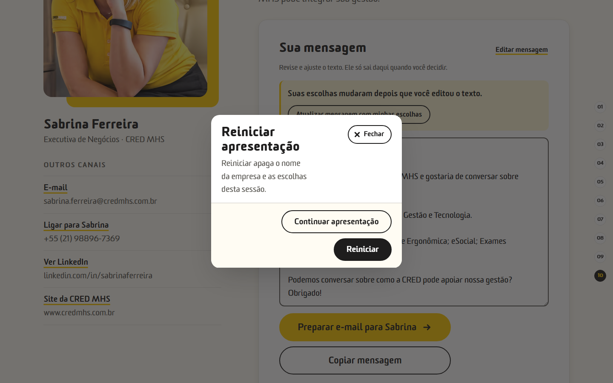

- Menu "Conteúdo" → **"Nova apresentação"** → janela *"Começar uma nova apresentação apaga o nome da empresa, as prioridades e a pauta desta sessão. O executivo continua o mesmo."* → **"Começar nova"** (ou "Continuar apresentação" para desistir). *(A captura acima é anterior à troca do rótulo.)*
- Apaga nome da empresa, prioridades, assuntos, itens livres, mensagem editada e o que estiver aberto. Mantém Sabrina como executiva e volta ao M01.

### O que fica salvo e quando some

- As escolhas (nome da empresa, prioridades e assuntos) ficam guardadas **só naquela aba do navegador**, enquanto ela estiver aberta. Recarregar a página (F5) **mantém** as escolhas.
- Fechar a aba apaga tudo. Uma aba nova começa vazia.
- A mensagem editada no M10 não fica salva: recarregar a página volta ao texto automático.
- Nada fica no servidor, e a CRED não recebe nada.

---

## 6. Três roteiros de uso

> O projeto não define tempos. Os tempos abaixo são **sugestão deste guia** para uma reunião de cerca de 25 a 30 minutos. Ajuste ao cliente.

### Antes de qualquer reunião

1. Abra o link e confira se a página carrega com a foto e o nome de Sabrina.
2. Se a aba já foi usada com outro cliente, **comece uma nova apresentação** (menu "Conteúdo" → "Nova apresentação"). O contador deve mostrar **"Sua pauta (0)"**.
3. Role até o M06 e veja se a animação toca. Se não tocar, veja o item 8.
4. Para tela compartilhada, compartilhe **a janela do navegador**, não a tela inteira, e deixe a janela larga (de preferência a partir de 1280 px, para mostrar o índice lateral).
5. Tenha em mente as pendências do item 9 para não afirmar o que a página evita afirmar.

### (a) Reunião ao vivo conduzida por Sabrina (presencial ou tela compartilhada)

| Etapa | Momento | Tempo sugerido | O que fazer |
|---|---|---|---|
| 1 | M01 | 1–2 min | Apresente-se. Clique em "Conhecer a CRED". |
| 2 | M02 | 3–4 min | Faça a pergunta *"O que merece mais atenção na sua operação hoje?"*. Marque até duas prioridades com o cliente. Pergunte se ele quer o nome da empresa na pauta. "Continuar". |
| 3 | M03 + M04 | 3 min | Números com os rótulos exatos. "Conhecer a estrutura" se houver interesse. Logos como "empresas no percurso". |
| 4 | M05 | 6–8 min | A frente da 1ª prioridade já abre. Explore, abra "Ver serviços" e use "Adicionar à conversa" quando o cliente demonstrar interesse. |
| 5 | M06 + M07 | 4–5 min | Mais tempo se Gestão e Tecnologia for prioridade. Senão, passe rápido e use "Ir para aplicações". Em M07, abra só a aplicação que interessar. |
| 6 | M08 | 1 min | Retome pessoas e estrutura. |
| 7 | M09 | 3–4 min | Revise a pauta com o cliente: remova, reordene e inclua assuntos com as palavras dele. |
| 8 | M10 | 2 min | Mostre a mensagem e os canais. Combine o próximo passo. |

**Dicas:** para pular, use o menu "Conteúdo" ou o índice lateral. Se o cliente mudar de ideia, troque as prioridades a qualquer momento ("Editar prioridades" no M09). Ao terminar, use **"Nova apresentação"** antes do próximo cliente.

### (b) Link enviado para leitura autônoma do cliente

> Só será possível **depois que a apresentação for publicada** num endereço da internet. Hoje ela é local.

- Envie o link com `?executivo=sabrina-ferreira`, com uma frase curta, por exemplo: "Preparei uma apresentação da CRED. No fim, você pode montar a pauta do que quer conversar comigo."
- O cliente navega sozinho, escolhe prioridades, monta a pauta e decide se usa "Preparar e-mail", "Copiar pauta" ou outro canal.
- **Sabrina não recebe aviso nem relatório** de que o cliente abriu a página ou do que escolheu. Só fica sabendo se ele enviar a mensagem ou entrar em contato. Combine um follow-up pelo canal habitual.
- Se quiser que ele comece num ponto específico, use um link com capítulo (ex.: `#ecossistema`).

### (c) Apresentação rápida (5 a 10 minutos)

1. **M01** (30 s): apresente-se.
2. **M02** (2 min): a pergunta das prioridades.
3. **M05** (3–4 min): só a frente da 1ª prioridade e, se couber, "Outras necessidades da operação". Adicione 1 a 3 assuntos.
4. **M09 → M10** (2 min): mostre a pauta e combine o próximo passo. Use o contador "Sua pauta (n)" no topo para ir direto.
5. Se o cliente quiser ver mais depois, ofereça o link para leitura com calma, depois da publicação.

### Depois da reunião

- **A pauta é a base da próxima conversa.** Use "Copiar pauta" no M09 (ou no M10) e cole numa anotação ou e-mail de follow-up antes de começar uma nova apresentação. O texto copiado traz o título (com o nome da empresa), "Sabrina Ferreira — Executiva de Negócios, CRED MHS", as prioridades e os assuntos.
- Em seguida, use **"Nova apresentação"** para não misturar com o próximo cliente.

---

## 7. Boas práticas e o que evitar

**Faça:**
- Deixe o cliente escolher. A força da apresentação está em ele ver a própria pauta montada.
- Use "Adicionar à conversa" no momento em que o interesse aparece, não no final.
- Revise a pauta junto com ele no M09.
- Reinicie entre um cliente e outro.

**Evite:**
- **Prometer além do texto.** A página não fala em preço, prazo, redução de custo, economia de FAP ou resultado garantido. Não acrescente isso apresentando a página.
- **Dizer que a página "analisou" a empresa.** As prioridades são escolhas do cliente, não diagnóstico.
- **Chamar logotipos de "clientes atuais"** ou atribuir cases a eles.
- **Mostrar a animação do M06 como tela do sistema.** Ela é conceitual.
- **Dizer "enviado"** depois de "Preparar e-mail". O cliente ainda precisa enviar pelo aplicativo dele.

**Dados que a página deixa de fora de propósito (e por quê):**

| O que não aparece | Por quê |
|---|---|
| Anos de experiência | O material traz 30, 34 e 35 anos em lugares diferentes. A página usa "experiência multissetorial" (P01) |
| "Entre as 5 maiores" | Sem fonte nem critério (P02) |
| "27 Estados atendidos" | A nomenclatura precisa de confirmação. A página usa "Atuação nacional" (P04) |
| ISO 9001 / 45001 / 27001 e LGPD | Sem titular, escopo e validade, com divergência entre slides (P05, P06) |
| "4 soluções para o eSocial" | As quatro modalidades não estão descritas (P08) |
| Nome "VIVA" | Não está no material da CRED (P16) |
| WhatsApp e botão "Agendar" | Canal não confirmado e sem link de agenda (P13, P14) |

Quando a CRED confirmar algum desses dados, ele pode entrar na página. Não é preciso refazer o layout.

---

## 8. Perguntas frequentes e solução de problemas

**A animação do M06 não toca ou aparece com erro.**
Recarregue forçando a atualização: **Ctrl+Shift+R** (no Mac, Cmd+Shift+R). Isso descarta arquivos antigos guardados pelo navegador. Se o vídeo continuar falhando, a página mostra uma imagem fixa no lugar, e o conteúdo em texto ao lado continua completo. Com "reduzir movimento" ativado no computador ou no celular, a página mostra a imagem fixa de propósito.

**As escolhas sumiram.**
Provavelmente a aba foi fechada, a página foi aberta numa aba nova ou alguém clicou em "Nova apresentação" ou em "Limpar escolhas". As escolhas ficam só na aba aberta. Recarregar (F5) não apaga.

**Cliquei em "Preparar e-mail" e nada abriu.**
O computador ou celular provavelmente não tem um aplicativo de e-mail configurado (comum em quem usa só o Gmail ou o Outlook no navegador). Use **"Copiar mensagem"** e cole num e-mail novo para sabrina.ferreira@credmhs.com.br, ou use **"Copiar pauta"**.

**O e-mail abriu sem o texto.**
A mensagem ficou longa e a página avisou. Use "Copiar mensagem" e cole no e-mail que abriu.

**Editei a mensagem e depois adicionei um assunto, mas ele não entrou no texto.**
É de propósito: a página não apaga o que foi escrito. Clique em **"Atualizar mensagem com minhas escolhas"**. Atenção: isso substitui o texto editado.

**Tentei escolher uma terceira prioridade e não deu.**
O limite é duas. Desmarque uma e marque a outra.

**O nome da empresa ficou na pauta depois de "Limpar escolhas".**
"Limpar escolhas" mantém o nome. Para apagar tudo, use "Nova apresentação".

**No celular não vejo o índice lateral.**
Ele só aparece em telas largas. No celular, use o botão de menu (☰) no topo.

**Abri o link com o nome errado do executivo.**
A página abre com Sabrina, que é o único perfil cadastrado.

**Quero mandar o link para um cliente.**
Ainda não é possível: a apresentação não foi publicada (veja o item 10).

---

## 9. Pendências que a Sabrina/CRED precisa confirmar

Resumo em linguagem simples. Os detalhes e o histórico estão em `docs/07-fontes-e-pendencias.md`, e o código de cada item está entre parênteses.

| ID | O que precisa ser confirmado |
|---|---|
| P01 | Quantos anos de experiência a CRED tem (o material diz 30, 34 e 35). |
| P02 | Fonte e critério do "entre as 5 maiores em Saúde e Segurança do Trabalho". |
| P03 | Data de referência dos números (16 unidades, +700 clínicas, +550 mil vidas, +5 mil clientes atendidos). |
| P04 | Se "27 Estados atendidos" pode ser usado assim (inclui o DF?). |
| P05 / P05a | Certificações ISO 9001, 45001 e 27001: de quem são (empresa ou sistema), escopo e validade. Os slides divergem. |
| P06 | Como falar de LGPD sem criar uma garantia nova. |
| P07 / P07a | Quais empresas devem aparecer em destaque, os arquivos oficiais dos logotipos e se cada uma pode ser citada. |
| P08 | Quais são as "4 soluções" para o eSocial. |
| P09 | Se "mais de 77 cursos" continua atual. |
| P10 | Se as siglas e normas do catálogo técnico continuam atuais. |
| P11 | O que significa "seu sistema" no FAP/NTEP. |
| P13 | Se o telefone de Sabrina atende pelo WhatsApp (para ligar o botão). |
| P14 | Se existe link de agendamento (hoje não há botão "Agendar"). |
| P15 | Arquivo oficial do logotipo em versão negativa e os pesos da fonte Sommet Rounded Thin e Heavy (a página usa Light/Regular e Black). |
| P17 | Quem assina o copyright que aparece no slide 16. |
| P18 / P22 | **Resolvido na página:** as frases de bastidor ("O material apresenta…", "descrito pela CRED…", "apresentada pela CRED") foram reescritas sem citar a fonte. Continua pendente a redação técnica validada pela CRED para qualquer menção à NR-7. |
| P21 | Aprovar os textos curtos de interface criados no projeto (ex.: "Na pauta", "Incluir outro assunto", "Mensagem preparada…", assunto do e-mail "Conversa sobre a CRED MHS"). |
| P23 | Se o e-mail de Sabrina pode ficar visível como texto na versão publicada. |

---

## 10. Parte técnica (resumo)

> **Não está publicado.** Não houve deploy, envio de e-mail, CRM nem analytics. Tudo roda localmente.

**Base:** Vite + React + TypeScript, sem backend. A animação do M06 foi feita com Remotion, em projeto separado na pasta `remotion/`.

**Comandos** (na pasta do projeto, com Node.js instalado):

```bash
npm install          # só na primeira vez
npm run dev          # desenvolvimento: http://localhost:5173/?executivo=sabrina-ferreira
npm run build        # verifica os tipos e gera a versão final em dist/
npm run preview      # serve dist/: http://localhost:4173/?executivo=sabrina-ferreira
```

**Onde fica cada coisa:**

| Pasta / arquivo | Conteúdo |
|---|---|
| `src/content/chapters.ts` | Textos de todos os momentos (títulos, apoios, botões, mensagens) |
| `src/content/executives.ts` | Perfil de Sabrina: nome, cargo, foto, e-mail, telefone, LinkedIn, WhatsApp (desligado) |
| `src/content/priorities.ts` | As 4 prioridades, o limite de 2 e o que cada uma destaca |
| `src/content/ecosystem.ts` | Frentes, catálogos e os 10 serviços adicionais |
| `src/content/applications.ts` | eSocial, FAP/NTEP, Riscos Psicossociais |
| `src/content/facts.ts` | Números do M03 e dados retidos por pendência |
| `src/content/clients.ts` | Empresas do M04 |
| `src/content/credentials.ts` | Certificações (ocultas até confirmação) |
| `src/components/sections/m07, m09, m10/microcopy.ts` e `m08/content.ts` | Textos curtos de interface desses momentos |
| `src/state/` e `src/lib/` | Regras de escolha, pauta, mensagem, contatos, reinício e o que fica salvo na aba |
| `docs/` | Especificação do projeto (00 a 07) e `STACK.md` |
| `qa/RELATORIO.md` | Relatório de testes: o que foi validado e o que ficou pendente |

**Para trocar um texto:** edite o arquivo de `src/content/` correspondente e rode `npm run build`. Dados confirmados pela CRED (por exemplo, WhatsApp ou ISO) são alterados num único lugar: perfil em `executives.ts`, certificações em `credentials.ts`. Registre a confirmação em `docs/07-fontes-e-pendencias.md`.

**Para um novo executivo:** acrescente um perfil real em `src/content/executives.ts` e use `?executivo=<id-do-perfil>`.

**Testado (ver `qa/RELATORIO.md`):** Chromium/Chrome no Windows, em larguras de 320 a 1440 px. Foram 106 testes de funcionamento sem falha e nenhuma violação na verificação automática de acessibilidade. **Não testado:** Safari e iPhone reais, Android real, leitores de tela reais e abertura real de e-mail, telefone e LinkedIn. Para este guia, as interações foram refeitas na versão local (4173) em 08/10/2026: prioridades e limite, nome da empresa, adicionar à conversa, pauta com item livre, mensagem editada e desatualizada, mensagem longa, copiar pauta, reinício, ID de executivo desconhecido e link direto por nome do capítulo.
